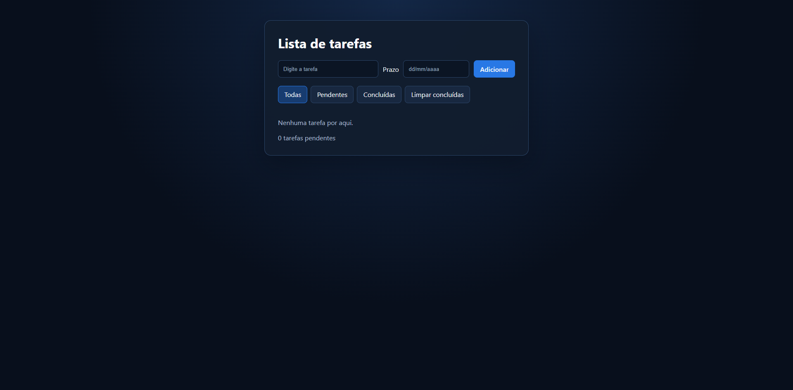

# Lista de tarefas

Aplicativo de tarefas feito com HTML, CSS e JavaScript puro, sem frameworks. Dá para adicionar tarefas com prazo, editar, concluir, filtrar e remover, e tudo fica salvo no navegador.

**Ver online:** https://ezimbrao.github.io/lista-tarefas/

<!-- TODO: grave um GIF curto (10 a 15 segundos) usando o app, ou tire um print, e salve
     na raiz do projeto como preview.gif ou preview.png. Ajuste o nome do arquivo abaixo. -->


## Funcionalidades

- Adicionar tarefas com **prazo opcional** no formato dd/mm/aaaa
- Validação: o texto da tarefa é obrigatório e o prazo precisa ser uma data real (31/02, por exemplo, é recusado, com mensagem de erro)
- Concluir pelo checkbox ou clicando no texto da tarefa
- **Editar o texto com duplo clique**: Enter salva, Esc cancela e clicar fora também salva; se o texto ficar vazio, o anterior é mantido
- Editar o prazo direto na lista (se a data for inválida, volta ao valor anterior)
- Tarefas pendentes sempre aparecem primeiro
- Filtros: todas, pendentes e concluídas
- Botão para **limpar as tarefas concluídas**
- Contador de tarefas pendentes
- Dados salvos no `localStorage`: continuam ali depois de recarregar a página
- Layout responsivo e tema escuro

## Tecnologias

- HTML5 semântico
- CSS3 puro (Flexbox, variáveis CSS e media queries)
- JavaScript (ES6+), sem bibliotecas e sem dependências

## Decisões de projeto

- **Estado como fonte da verdade.** As tarefas ficam em um array e a tela é sempre desenhada a partir dele, por uma função `renderizar()`. A ordenação (pendentes primeiro) é feita em uma cópia, sem alterar a ordem salva.
- **Delegação de eventos.** Como os itens são criados e removidos o tempo todo, poucos ouvintes na lista cuidam dos cliques, das mudanças e do duplo clique, em vez de um ouvinte por item.
- **Clique simples x duplo clique.** O clique no texto conclui a tarefa e o duplo clique abre a edição. Para os dois conviverem, o clique simples espera 500 ms e é cancelado se vier um segundo clique.
- **`textContent` em vez de `innerHTML`.** O texto digitado pelo usuário nunca é interpretado como HTML, o que evita a injeção de código (XSS), inclusive no campo de edição.
- **Datas validadas de verdade.** O prazo digitado é conferido com expressão regular e com o calendário (em UTC, sem depender do fuso horário) e guardado em formato ISO (aaaa-mm-dd). Só na hora de exibir é que volta para dd/mm/aaaa.
- **Edição que finaliza uma única vez.** Uma marca no campo impede que Enter seguido de perda de foco salve duas vezes.
- **Armazenamento com proteção.** A leitura e a escrita no `localStorage` usam `try/catch`, então dados corrompidos ou um navegador que bloqueia o armazenamento não quebram o app.

## Acessibilidade

- Campos com `label` associado e texto de ajuda do prazo ligado por `aria-describedby`
- Contador com `aria-live`, que avisa leitores de tela quando muda
- Filtros com `aria-pressed` indicando o filtro ativo
- Rótulos descritivos (`aria-label`) nos campos de prazo, no botão de remover e no campo de edição
- Foco visível nos botões e campos
- Ao concluir pelo checkbox, o foco volta para o mesmo item depois que a lista é redesenhada

**Limitação conhecida:** a edição do texto só existe por duplo clique, sem equivalente para teclado e toque. Está nos próximos passos.

## Estrutura de arquivos

```
.
├── index.html    # estrutura da página
├── style.css     # estilos
├── script.js     # estado, renderização e eventos
├── preview.png   # imagem usada neste README
└── README.md
```

## Como rodar no seu computador

1. Baixe ou clone o repositório.
2. Abra a pasta no VS Code e use a extensão **Live Server** ("Go Live"), ou abra o `index.html` direto no navegador.

## Como publicar

O projeto é estático. No GitHub Pages:
**Settings → Pages → Deploy from a branch → `main` / `(root)` → Save.**

## O que aprendi

<!-- TODO: escreva com suas palavras 3 ou 4 aprendizados reais. Por exemplo:
     - o que mudou no seu jeito de pensar ao separar estado e tela
     - a dificuldade de fazer clique simples e duplo clique conviverem
     - por que validar datas dá mais trabalho do que parece
     - algo que você faria diferente se começasse de novo -->

## Próximos passos

- [ ] Botão "Editar" em cada tarefa, para funcionar com teclado e toque
- [ ] Prazo com máscara automática ou seletor de data nativo, para facilitar a digitação no celular
- [ ] Pedir confirmação antes de limpar as concluídas
- [ ] Testes automatizados
- [ ] Refazer o projeto em React para comparar as abordagens

## Autor

**Enzo Zimbrão** · São Paulo, SP · [GitHub](https://github.com/ezimbrao)
